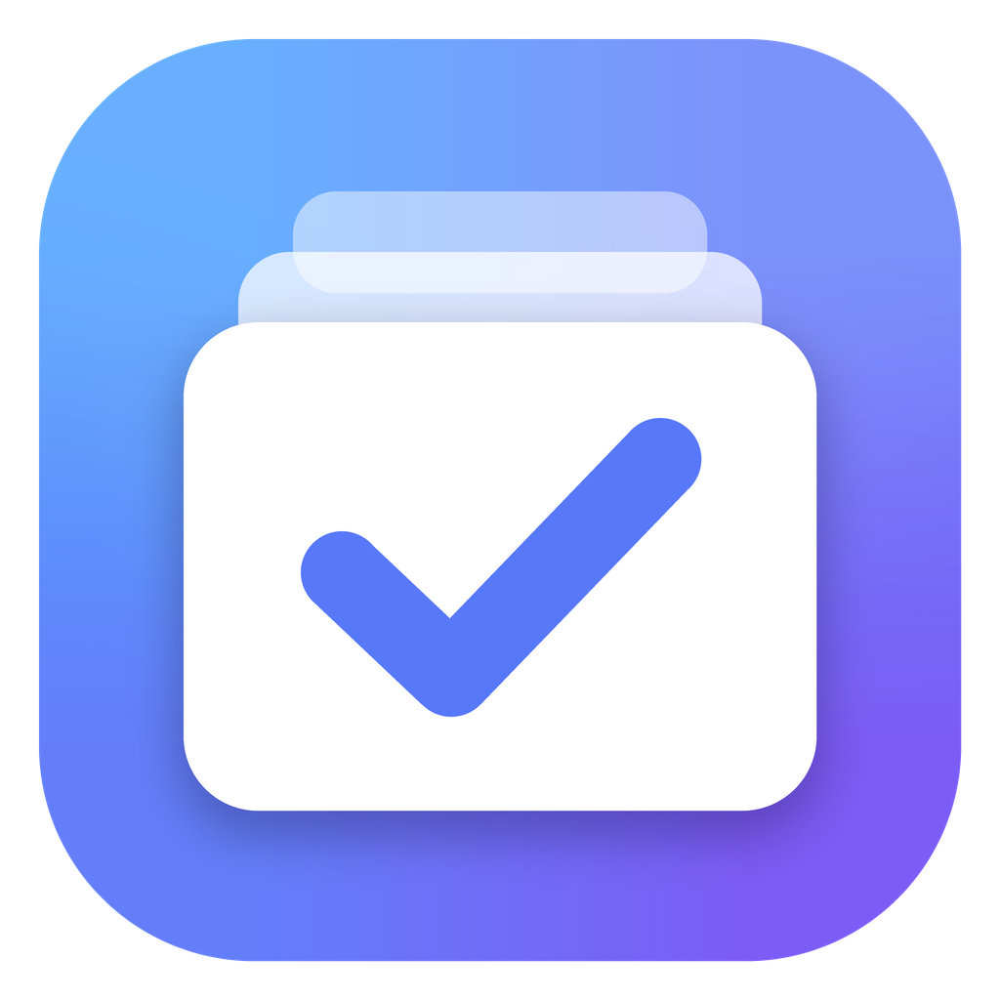
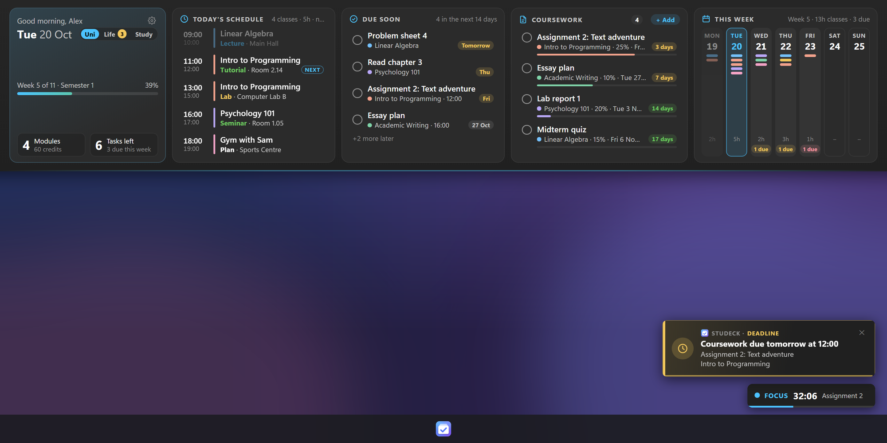
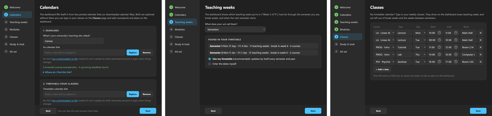
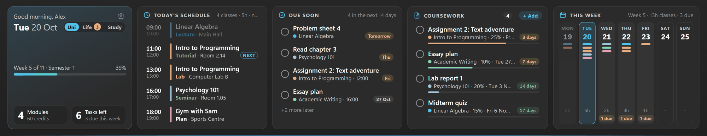
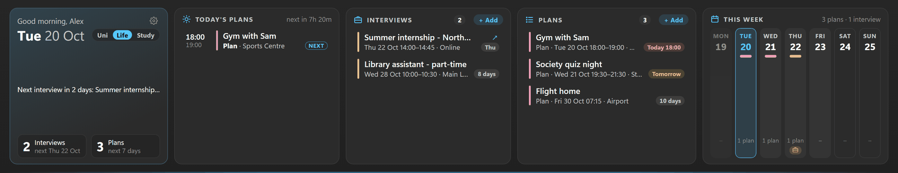
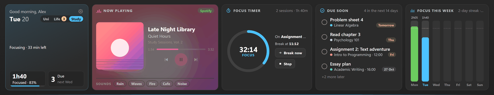
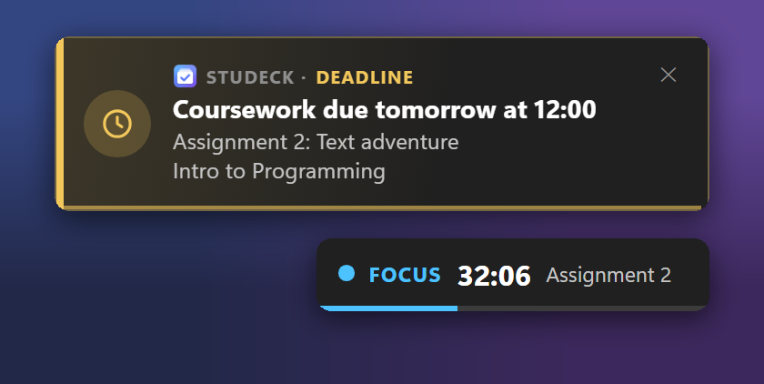
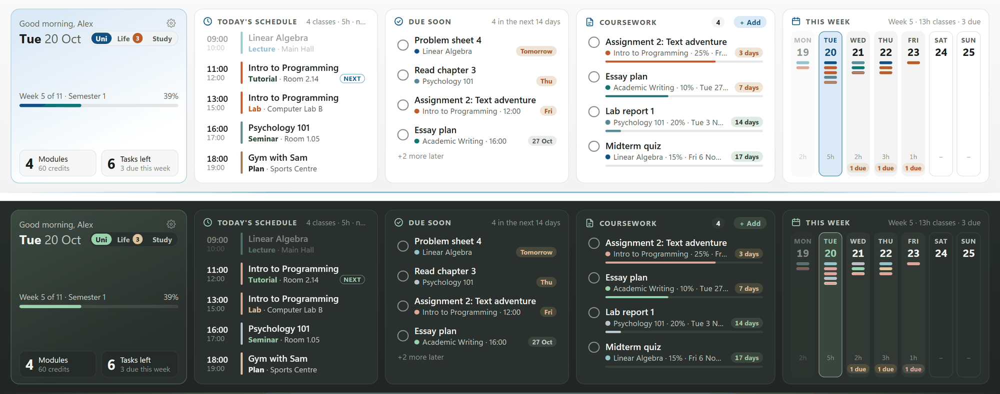

<p align="center"></p>

<h1 align="center">Studeck</h1>

<p align="center">
  A student dashboard that drops down from the top of your screen:<br>
  today's classes, deadlines, coursework, plans, your music and a focus timer, at a glance.
</p>



Studeck fills itself in from your university timetable and your learning
site's deadline calendar (Moodle, Canvas, Blackboard, Brightspace... any
calendar with a private `.ics` link, or a downloaded `.ics` file), and works out
your semesters (or terms, trimesters, quarters) by itself. No calendar? Type
your weekly classes in once instead. It isn't tied to any one university.

- **Uni:** today's schedule, deadlines due soon, coursework (with weights,
  progress and links), the week ahead, and which teaching week you're in.
- **Life:** interviews, events and other plans.
- **Study:** what's playing in Spotify with its controls, ambient sounds, and a
  Pomodoro focus timer with a daily goal and streak.
- **Pop-ups and reminders:** *Today at a glance* each morning, a *weekly review*
  on Sunday evenings, and deadline reminders in Studeck's own notification cards.

**Windows 10/11** is fully supported. **macOS is in beta** (see
[Mac notes](#mac-beta)).

## Install

You don't need git, Python or a GitHub account: just download the app.

### Mac (beta, Apple silicon: M1 or newer)

1. Go to the [**latest release**](https://github.com/ethan27v/Studeck/releases/latest)
   (on this repository's page, that's **Releases** in the right-hand column).
2. Under **Assets** at the bottom, click **`Studeck-Mac.dmg`** to download it.
3. Open the downloaded `Studeck-Mac.dmg` (in **Downloads**). In the window that
   opens, drag the **Studeck** icon onto the **Applications** folder.
4. Open **Studeck** from your **Applications** folder (not from the window in
   step 3: run from there, *Open at login* won't work). You can then eject the
   Studeck disk in Finder's sidebar and delete the `.dmg`.
5. The first time, macOS says it can't check Studeck for malicious software
   (Studeck isn't registered with Apple, which costs money). Click **Done**,
   then open **System Settings → Privacy & Security**, scroll down to
   *"Studeck" was blocked* and click **Open Anyway**, then **Open Anyway**
   again and enter your Mac's password. macOS only asks once.
6. The **setup window** opens (see [First-time setup](#first-time-setup)).
   Afterwards, open the dashboard with **⌃⌥D** (Control+Option+D) or the
   Studeck icon in the menu bar at the top of the screen.

If it doesn't open:
- *"Studeck is damaged and can't be opened"*: open **Terminal** (in
  Applications → Utilities), paste `xattr -cr /Applications/Studeck.app`,
  press Return, and open Studeck again.
- Not sure which Mac you have? Apple menu  → **About This Mac**: *Chip:
  Apple M…* works. *Processor: Intel* doesn't yet (developers can use the
  [run from source](#for-developers-run-from-source) steps below).

### Windows 10/11

1. Go to the [**latest release**](https://github.com/ethan27v/Studeck/releases/latest)
   (on this repository's page, that's **Releases** in the right-hand column).
2. Under **Assets** at the bottom, click **`Studeck-Windows.zip`** to download it.
3. In **Downloads**, right-click `Studeck-Windows.zip` → **Properties**, tick
   **Unblock** at the bottom and click **OK**. (Windows marks downloads as
   unknown; unblocking first means it won't stop Studeck from starting.)
   Then right-click it again → **Extract All…**, and
   choose a folder you'll keep, e.g. **Documents**. (Don't run it from inside
   the zip, and keep the whole `Studeck` folder together: `Studeck.exe` needs
   the `_internal` folder next to it.)
4. Open the `Studeck` folder and double-click **`Studeck.exe`**.
5. The first time, Windows may say *"Windows protected your PC"* (Studeck
   isn't signed, which costs money). Click **More info** → **Run anyway**.
   Windows only asks once. If instead **Smart App Control** blocks it, Windows
   offers no "Run anyway" for unsigned apps: use the
   [run from source](#for-developers-run-from-source) steps (they run through
   Python, which is signed). Turning Smart App Control off also works, but
   Windows can't turn it back on without a reinstall.
6. The **setup window** opens (see [First-time setup](#first-time-setup)).
   Afterwards, open the dashboard by resting the mouse on the very top edge of
   the screen, or with **Ctrl+Alt+D**.

If nothing appears: the window is drawn by Microsoft's **WebView2 runtime**,
which comes with Windows 11 and up-to-date Windows 10. Install the *Evergreen
Bootstrapper* from [Microsoft's WebView2 page](https://developer.microsoft.com/microsoft-edge/webview2/)
and try again.

The app keeps everything you enter in the `.studeck` folder in your home
folder, so updating or reinstalling it never loses your data (see
[Your data and privacy](#your-data-and-privacy)).

### For developers: run from source

Most people should use the app above. To run Studeck from its code instead,
you need **Python 3.10 or newer** from [python.org](https://www.python.org/downloads/)
(on Windows the Microsoft Store version works too; on a Mac, Homebrew's works
too, but the `python3` that comes with macOS is 3.9, which is too old).

1. Download this repository (**Code → Download ZIP** and unzip it, or
   `git clone` it) into a folder you'll keep, e.g. `Documents/Studeck`.
2. Install the add-ons (optional: the start files in step 3 install them
   themselves the first time). Open a terminal in that folder and run:

   **Windows**
   ```
   python -m pip install -r requirements.txt
   ```
   **Mac** (the add-ons go in a `.venv` folder inside Studeck's folder, which is
   what the start file uses)
   ```
   python3 -m venv .venv
   .venv/bin/python -m pip install -r requirements.txt
   ```

3. Start it:
   - **Windows:** double-click `Start Studeck.bat`. It installs the add-ons
     itself if you skipped step 2. The window is drawn by
     Microsoft's **WebView2 runtime**, which comes with Windows 11 and
     up-to-date Windows 10. If nothing appears, install the *Evergreen
     Bootstrapper* from [Microsoft's WebView2 page](https://developer.microsoft.com/microsoft-edge/webview2/).
   - **Mac:** double-click `Start Studeck.command` (the first time, macOS may
     say it can't check it: right-click it → **Open** → **Open**). It installs
     the add-ons itself if you skipped step 2. Or, in a terminal in the folder:
     `.venv/bin/python dashboard.py`.
     - If macOS says you *don't have appropriate access privileges* (this
       happens when the folder was copied over from a Windows PC), open
       Terminal in the folder and run `chmod +x "Start Studeck.command"`.

## First-time setup

The first time it runs, a **setup window** walks you through everything (about
two minutes). Change any of it later from the **⚙** on the dashboard or the
tray / menu bar icon → **Settings**.



1. **You:** your name for the greeting, and how to open the dashboard.
2. **Calendars:** paste two private links. The window shows where to find
   them for Moodle, Canvas, Blackboard, Brightspace, Sakai, timetable websites,
   and Outlook, Google and Apple calendars, and checks each one ("Connected · 90
   classes · 2 semesters found"). If your uni only lets you *download* a
   calendar, pick the `.ics` file instead. Both are optional.
   - **Deadlines:** your learning site's calendar (and what it's called, so the
     dashboard says "from Moodle").
   - **Timetable:** your classes, e.g. the *Subscribe* / *Export* / *iCal* link
     on your uni's timetable website, or the Outlook or Google calendar your
     timetable is in.
3. **Teaching weeks:** what your uni calls them (semesters, terms, trimesters
   or quarters), found in your timetable, or enter the dates yourself.
4. **Modules:** every course in your timetable, this semester and next, with a
   short code and a colour you can change, or hide. Add any that aren't there.
5. **Classes:** no timetable calendar? Type in your weekly classes (course,
   type, day, time, room). They're left out of break weeks.
6. **Study & look:** colours, focus timer lengths, daily focus goal, start at
   login, pop-ups and reminders.

## Using it

- **Open:**
  - Windows: rest the mouse on the very top edge of the screen for a moment,
    or press **Ctrl+Alt+D**.
  - Mac: press **⌃⌥D** (Control+Option+D), or click the menu bar icon.
- **Quick add:** **Ctrl+Alt+A** (Mac **⌃⌥A**) anywhere: type one line and press Enter.
  `CS essay fri 12:00` (a module code makes it coursework for that course),
  `Interview Google 3 Nov 14:00` (an interview), `Read chapter 4 tomorrow`
  (anything else goes to your plans). Dates can be `today`, `tomorrow`, `fri`,
  `next wed`, `in 3 days`, `23 Oct` or `23/10`; times `12:00`, `4pm` or `noon`.
- **Close:** move the mouse off the panel, press **Esc**, or press the shortcut again.
- **Tick things off:** click the circle next to a task or a piece of coursework.
- **Switch view:** **Uni | Life | Study** next to the date.
- **Quit, settings, pop-ups:** the tray icon (Windows: bottom-right of the
  taskbar, you may need the `^` arrow) or the menu bar icon (Mac).

On Windows it won't open while a full-screen app (game, video, slideshow) is
running, or while you're dragging a window.

## Uni: classes, deadlines and coursework



- **Add:** **+ Add** on the Coursework card: title, course, due date and time,
  and optional weight %, progress and a link. Enter saves, Esc cancels.
- **Edit:** click any coursework. Deadlines from your learning site keep its
  title and date, but you can set the course, weight, progress and link
  (its calendar doesn't say which course a deadline is for).
- **Paste a schedule:** **+ Add → Paste schedule**, then paste a course
  schedule (a web page, handbook or email; tables work best). It finds each
  coursework's title, release date, due date, time and weight for you to
  check. It understands "Fri 23 Oct", "23/10/2026" (UK style) and "Week 9
  Friday" (from your semester start).
- **Import a module calendar (.ics):** on the same screen, import a file or
  paste a calendar link; "CW1 released" + "CW1 due" become one item.
- **Release dates** show **Opens Mon 26 Oct**, then **Out now** for a week.
- **Tutorial tomorrow:** a note at the top of today's schedule, so there's time
  to do the sheet.
- **Reminders:** a notification **3 days** and **1 day** before, and at **8:30**
  on the morning something is due (no time counts as 23:59); interviews the day
  before and an hour before. If your computer was off, you get one catch-up
  reminder.

## Life: interviews and plans



**+ Add** on the Interviews or Plans card: type, title, date, times, where (a
place or a video-call link) and notes. They also show in the Uni view's
schedule and week, the day before an interview you get a heads-up, and online
interviews get a **Join** button.

## Study: music, sounds and focus timer



- **Now playing** shows what's playing in **Spotify** with play / pause,
  previous, next and a progress bar you can click. You choose the music in
  Spotify itself; there's no account to link, and Spotify Free works.
  - Windows: also anything in Windows' media pop-up (a browser tab, VLC,
    Apple Music...).
  - Mac: Spotify and Apple Music. macOS doesn't let apps read other "now
    playing" sources.
- **Sounds:** real recordings of Rain, Waves, a Fire and a Cafe, plus brown
  Noise, with a volume slider. They keep playing while the panel is closed.
- **Focus timer:** pick 25, 50 or 90 minutes (with a 5, 10 or 15 minute
  break), optionally the coursework you're working on, and **Start focus**.
  It keeps going round (focus, break, focus, break, the same lengths each
  time) until you press **Stop**, with a notification at each change; your
  music keeps playing throughout. **Break now** / **End break** skip ahead. A
  small timer sits in the bottom-right corner while it runs; click it to come
  back.
- **Daily goal and streak:** the **Focused** box fills up towards your daily
  goal, and **Focus this week** shows a bar per day and your streak.
- **Time per coursework:** sessions on a coursework add up ("3h 20m focused").

## Notifications and pop-ups

<p align="center"></p>

**Notifications** (deadline and interview reminders, the focus timer) are
Studeck's own cards in the bottom-right corner, in the dashboard's colours:
amber for deadlines, violet for interviews, your accent colour for focus and
green for breaks. They stay for 8 seconds (longer while the mouse is on one);
click one to open the dashboard on the right page. They wait while a
full-screen game, video or slideshow is running. Settings → Study & look →
**Show a test notification** shows you one.

- **Today at a glance:** the first time you use your computer each day,
  everything for today, tomorrow and the rest of the week.
- **Weekly review:** Sunday from 6pm: focus time, what you submitted, what's
  overdue, and next week's classes and deadlines.

Open either any time from the tray / menu bar icon, or switch them off in Settings.

## Colours

**Match my computer** (the default) follows Windows' or macOS's light / dark
mode and your accent colour. There are also Dark, Light, **Sage**, **Sand** and
**Midnight** themes: Settings → Study & look → Colours.



## How it keeps up by itself

- **Semesters.** From your timetable Studeck finds each block of teaching weeks
  (a gap of two weeks or more, like the winter break, starts a new one) and any
  weeks with no classes inside it (reading weeks). They're numbered in order
  through your academic year, which starts again after the long summer break,
  so it works whenever your year starts (September, February...) and however
  many terms it has. It shows "Week 5 of 11 · Semester 1", a progress bar,
  "break" weeks, "Break · Semester 2 starts Mon 11 Jan" between them (with your
  own dates), and "teaching finished" after the last one. Nothing to update
  each term or year: a new one appears when your university adds it to your
  timetable. If you'd rather, enter the dates yourself in Settings → Teaching weeks.
- **Modules.** Courses come from your timetable too, each with a code (e.g.
  *LA* for Linear Algebra) and a colour that stays the same.
  When the next semester starts, its courses take over the **Modules** count by
  themselves; old courses keep their colours on old coursework.
- **Deadlines.** New deadlines arrive from your learning site's calendar (every
  15 minutes; a downloaded `.ics` file only changes when you pick a new one),
  and past ones drop off. Sites can take a day or more to update
  the shared calendar, so the site itself is always the final word.
- **Offline.** The last synced copy is shown. A small dot next to *Today's
  schedule* and *Coursework* says how fresh it is: green synced, amber showing
  the saved copy, red the link isn't working (hover for details).

## Your data and privacy

- **Your own data** is `state.json` (your coursework, plans, ticks and
  settings) and, if you made one, `my-data.js`. The downloaded app keeps them
  in the `.studeck` folder below. Run from source, they sit in the app folder
  instead: both are in `.gitignore`, so they never end up in the repository and
  `git pull` never touches them. (The first time the downloaded app starts, it
  copies any `state.json` / `my-data.js` it finds next to it.)
- **`.studeck` in your home folder** (`%USERPROFILE%\.studeck`
  on Windows, `~/.studeck` on Mac) holds your private calendar links,
  the calendar cache, the log, and the reminder, pop-up and focus timer records.
- Treat the calendar links like passwords: anyone with one can read that
  calendar. They're only stored on your computer.
- Studeck doesn't send your data anywhere. It only downloads your own
  calendar links (and, on a Mac, Spotify's album covers).

**Advanced:** weekly classes, to-dos and extra coursework can also go in
`my-data.js` (Settings → You → *Open my data file*). It starts as a copy of the
sample `data.js`, and the dashboard reloads when you save it. Settings from the
setup window take priority over the same things there.

## Updating and uninstalling

- **Update (downloaded app):** quit Studeck (tray / menu bar icon → **Quit**),
  download the latest release and install it the same way:
  - Mac: open the new `.dmg`, drag Studeck onto Applications and choose **Replace**.
  - Windows: extract the new zip and replace the old `Studeck` folder with it,
    in the same place.

  Your data in `.studeck` stays.
- **Update (from source):** `git pull` in the folder (or download the ZIP again
  and copy your `state.json` and `my-data.js` across), then quit and restart
  Studeck.
- **Uninstall:** turn off **Start with Windows** / **Open at login** in the tray /
  menu bar menu, quit, then delete the app folder (or `Studeck.app`) and the
  `.studeck` folder in your home folder.

## Mac (beta)

The Mac version uses the same app with Mac-specific window, menu bar, hotkey
and media code (`desktop_mac.py`). It hasn't had much real-world testing yet,
so please [open an issue](../../issues) with the log
(`~/.studeck/dashboard.log`) if something doesn't work.

- It opens with **⌃⌥D** or the menu bar icon (the top edge of the screen is the
  menu bar), and sits just below the menu bar.
- The first time it controls Spotify or Music, macOS asks whether it may: say OK.
- **Open at login** adds a LaunchAgent (`~/Library/LaunchAgents/com.studeck.plist`).
- Run from source, if calendar links fail with a certificate error, run
  *Install Certificates.command* from your Python folder in Applications.

A first Mac test, in order: the setup window opens; ⌃⌥D shows and hides the
panel; the menu bar icon's menu works; a calendar link connects; Spotify's song
shows on the Study page; a 1-minute focus timer ends with a notification and
the corner timer appears; *Open at login* survives a restart.

## Light on your computer

- The mouse is checked often only near the top edge or while the panel is open,
  and rarely elsewhere (on a Mac, once a second until you open it).
- While hidden the panel isn't redrawn every minute, and it stops asking
  what's playing.
- On Windows, syncing, reminders and other background jobs run at low priority
  in efficiency mode. A calendar that hasn't changed isn't read again.

## Tweak it

At the top of `dashboard.py`: panel height (`HEIGHT_RATIO`, with `MIN_PANEL` /
`MAX_PANEL` so it suits small laptops and big monitors), how long to rest at the
top before it opens (`DWELL_SECONDS`), how quickly it hides, and how long
notifications stay (`TOAST_SECONDS`).

## For developers

- `dashboard.py`: the app: windows, threads, tray / menu bar, the page API.
- `desktop_win.py` / `desktop_mac.py`: everything platform-specific.
- `calendars.py`: calendar links, syncing, and finding semesters in a timetable.
- `media.py`: now playing (Windows media controls / AppleScript) and the focus timer.
- `reminders.py`: deadline and interview notifications.
- `app.js`, `importer.js`, `styles.css`, `index.html`: the panel;
  `summary.html` / `review.html`: the pop-ups; `settings.html` / `settings.js`:
  setup and settings; `mini.html`: the corner timer; `toast.html`: notifications.
- `icons/`: the app icon; `python icons/make_icons.py` draws it again.
- `docs/`: the README pictures (made-up demo data).
- Checks: `python -m unittest discover -s tests -v`. GitHub Actions runs them on
  Windows and macOS for every push (`.github/workflows/check.yml`).
- Packaged app: `python -m pip install pyinstaller`, then
  `python -m PyInstaller studeck.spec --noconfirm` builds `dist/Studeck/Studeck.exe`
  (Windows) or `dist/Studeck.app` (Mac). Pushing a `v*` tag
  (`git tag v1.0.0 && git push origin v1.0.0`) builds both on GitHub Actions and
  attaches `Studeck-Windows.zip` and `Studeck-Mac.dmg` to a release
  (`.github/workflows/release.yml`). Pushing any other branch than `main`
  builds the same two files without a release, to try out first: they're
  under **Artifacts** on that run's page in the **Actions** tab.
- `index.html` (or `index.html?pin` to keep it open) previews the panel in a
  browser; add `?date=2026-10-20&time=10:40` to preview another day.

## Licence

MIT. See [LICENSE](LICENSE). The ambient recordings in `sounds/` are CC0
(public domain) by Joseph Sardin, [BigSoundBank.com](https://bigsoundbank.com);
see `sounds/CREDITS.txt`.
